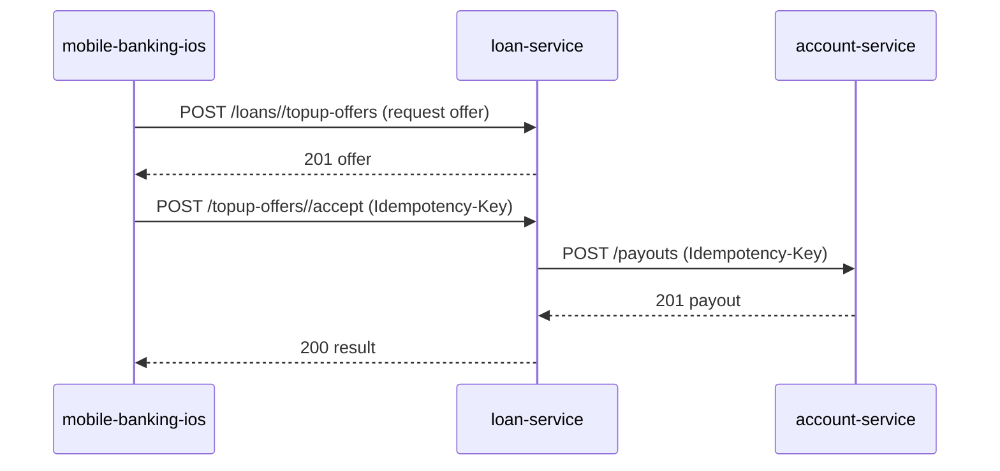

## Context
The mobile iOS app needs to allow personal-loan customers to request a top-up, view an indicative offer and receive the net amount in their repayment account.

## Components and responsibilities
- **mobile-banking-ios**: UI flow, calls lending-topup-v1 (offer & accept) and displays results.
- **loan-service**: Calculates eligibility, generates indicative offer, stores offer, processes acceptance, calls deposits-payouts-v1 for payout, creates new loan record.
- **account-service**: Receives payout request, validates account, applies idempotency, updates ledger.

## Sequence

## Rules applied
- TU-1a-TU-1c: eligibility checks.
- TU-2a-TU-2c: amount and term limits.
- TU-3a-TU-3b: rate and arrangement fee calculation.
- TU-4b-TU-4c: offer presentation and expiry.
- TU-5e-TU-5f: idempotent acceptance and confirmation details.
- REG-5: storage of offer and acceptance timestamp.
- ARC-6: data ownership – loan data owned by loan-service, account balances owned by account-service.

## Non-functional
- **Idempotency**: Idempotency-Key header required on acceptance and payout.
- **Timeouts**: 5 s for inter-service calls.
- **Security**: OAuth2 token (out of scope for demo), internal TLS.
- **Logging**: Correlation IDs propagated.

## Simplifications in the demo
- Credit decision always positive.
- No real SCA or AML monitoring.
- In-memory data stores.
